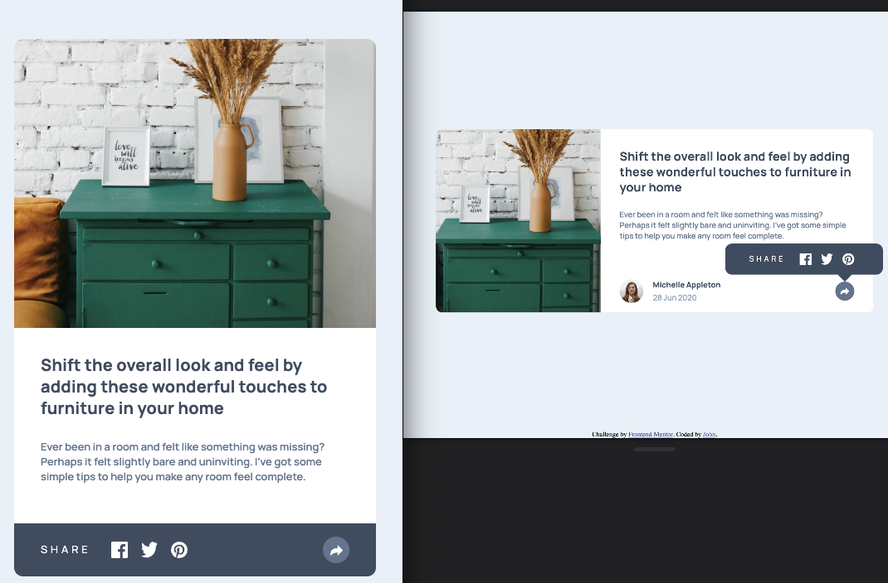

# Frontend Mentor - Article preview component solution

This is a solution to the [Article preview component challenge on Frontend Mentor](https://www.frontendmentor.io/challenges/article-preview-component-dYBN_pYFT). Frontend Mentor challenges help you improve your coding skills by building realistic projects. 

## Table of contents

- [Overview](#overview)
  - [The challenge](#the-challenge)
  - [Screenshot](#screenshot)
  - [Links](#links)
- [My process](#my-process)
  - [Built with](#built-with)
  - [What I learned](#what-i-learned)
  - [Continued development](#continued-development)
  - [Useful resources](#useful-resources)
  - [AI Collaboration](#ai-collaboration)
- [Author](#author)
- [Acknowledgments](#acknowledgments)

**Note: Delete this note and update the table of contents based on what sections you keep.**

## Overview

### The challenge

Users should be able to:

- View the optimal layout for the component depending on their device's screen size
- See the social media share links when they click the share icon

### Screenshot

### Links

- Solution URL: [GitHub repo here](https://github.com/RoomForEpsilon/article-preview-component)
- Live Site URL: [Add live site URL here](https://your-live-site-url.com)

## My process

### Built with

- Semantic HTML5 markup
- CSS custom properties
- Flexbox
- Mobile-first workflow
- [React](https://reactjs.org/) - JS library

### What I learned

This is the second project where I used flex as a row instead of a column, and figuring out how to fit the image to take up the entire height of the card was difficult, and I'm not sure I'll be able to quickly get it working the next time I have to do that again.  Still, I have a better understanding of why it wasn't working: Height does not behave like width, so height: 100% doesn't give the image 100% of the height of the parent if the parent hasen't been given a height.  In order to solve this issue, I ended up setting the container to flex, and then setting align-self: stretch on the image.

Another thing I learned was using the aria-expanded and aria-controlls attributes.  Since the social media links box is hidden when the page is loaded, aria-expanded and controlls helps screen readers make sense of that part of the page.

The actual JavaScript part wasn't that hard, because I read a little from a Javascript textbook.  It felt like nienty percent of this project was styling the page, ten percent was javascript. 

### Continued development

I don't believe there is a next step for this particular project, but I would definitely use what I've learned on this project if I needed to create part of a page that functioned like an article preview.  

### Useful resources

- [Article about the problem of percentage-based heights](https://www.joshwcomeau.com/css/height-enigma/) - This article helped me understand the issue with setting an image with height: 100% and not having the image take up the height of its container.

- [Video about aria attributes](https://www.youtube.com/watch?v=iiD8TAI1PBM) - This YouTube video explained aria-expanded and aria-controls.  What I really liked is the suggestion for developers to use a screen reader to check how their websites are used by screen readers.

### AI Collaboration

I used ChatGPT for some questions and for reviewing my project.  I invested a lot of time reading through articles or posts rather than asking ChatGPT for a quick answer.  I think using AI for answers can provide the same learning experience as not using AI more quickly, but it can also easily solve problems for me that prevents me from learning.  Reading articles and posts helped me to wrap my head around some problems, like why height: 100% wasn't working, so I think its good to have that as part of my learning repitoire.

## Author

- Frontend Mentor - [@RoomForEpsilon](https://www.frontendmentor.io/profile/RoomForEpsilon)
